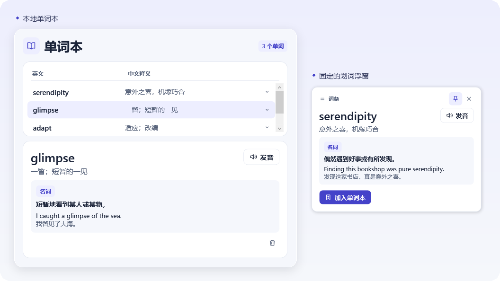

<div align="center">

<h1>WordAss</h1>

<p>Windows 划词词典、段落翻译与本地单词本。</p>

<p><code>Windows x64</code> &nbsp; <code>.NET Framework 4.8+</code> &nbsp; <a href="LICENSE"><code>MIT</code></a></p>

<p><a href="#快速开始">快速开始</a> · <a href="#功能">功能</a> · <a href="#api-配置">API 配置</a></p>

</div>



## 快速开始

在 64 位 Windows 上，用 PowerShell 获取源码并运行构建脚本。脚本使用 Windows 上的 .NET Framework 编译器生成 `build\WordAss.exe`。

```powershell
git clone https://github.com/HOWARD-mzYANG/wordass.git
cd wordass
powershell.exe -NoProfile -ExecutionPolicy Bypass -File .\build.ps1
```

打开 `build\WordAss.exe`。首次启动时，在设置里填入 API 配置并点击 **验证并保存**。之后可以从系统托盘打开单词本或调整设置。

## 功能

| 场景 | 操作 |
| --- | --- |
| **查单词** | 在其他应用里选中英文单词，点击鼠标旁的 **翻译**，查看词性、中文释义和例句。支持播放系统英文语音和收藏。 |
| **翻译段落** | 选中句子或段落，点击 **翻译**，查看整段译文。 |
| **保留查询结果** | 拖动顶栏移动浮窗，点击图钉固定或取消固定。继续划词时，已固定的浮窗会留在屏幕上。 |
| **复习词条** | 双击托盘图标打开单词本。列表显示英文和中文简释，点开查看详情，或用垃圾桶图标删除已掌握的词。 |
| **开机启动** | 在托盘的 **设置** 中开启。下次登录 Windows 后，WordAss 会在托盘运行。 |
| **切换风格** | 在托盘的 **设置 → 界面风格** 中选择 **现代** 或 **旧书**。选择立即生效，并在下次启动时沿用。 |

部分应用无法直接读取选区。可以先复制文字，再用托盘里的 **查译剪贴板**。默认快捷键是 <kbd>Ctrl</kbd> + <kbd>Alt</kbd> + <kbd>D</kbd>，备用组合键会显示在托盘菜单中。

## API 配置

| 服务 | 配置方式 |
| --- | --- |
| **DeepSeek（默认）** | 填入 DeepSeek API Key。默认模型为 `deepseek-flash`，旧版保存的 Key 可以继续使用。 |
| **自定义 OpenAI 兼容 API** | 填入基础地址、模型名称和 API Key。服务需支持 `POST /chat/completions`，基础地址示例为 `https://api.openai.com/v1`。本机服务可使用 HTTP，无需鉴权时可勾选相应选项。 |

保存前会发送一条简短测试请求。日常使用时，选中文字会在你点击 **翻译** 后发送给所选服务。

## 本地数据

| 文件 | 用途 |
| --- | --- |
| `%LOCALAPPDATA%\WordAss\wordbook.xml` | 保存收藏词条，可离线查看。 |
| `%LOCALAPPDATA%\WordAss\api-settings.dat` | 使用 Windows 当前用户加密保存的 API 配置和 Key。 |
| `%LOCALAPPDATA%\WordAss\appearance.txt` | 保存界面风格偏好。 |

## 开源协议

WordAss 采用 [MIT 协议](LICENSE)。
